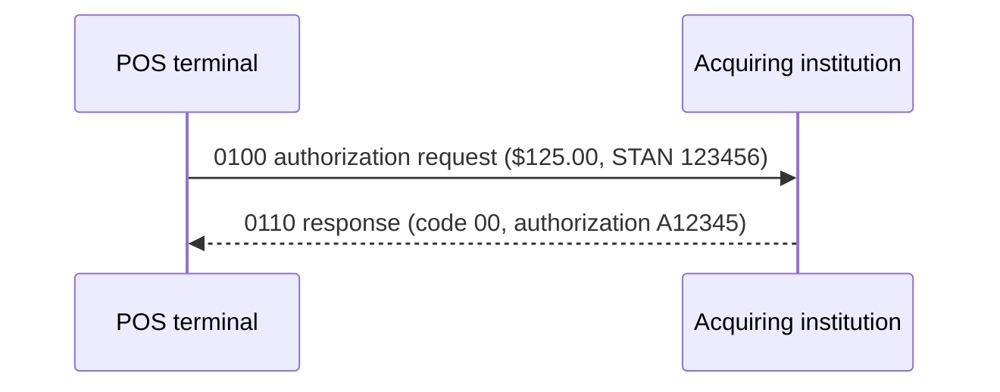

# ISO 8583 Core

A dependency-free, performance-oriented ISO 8583 codec implemented consistently in Go, C#, and C++17.

## Features

- Binary primary and secondary bitmaps (fields 2-128)
- Fixed, LLVAR, and LLLVAR byte fields
- Strict validation for undefined, oversized, truncated, and trailing data
- Caller-owned output buffers in each implementation's fast path
- Immutable message specifications after construction
- No runtime dependencies outside each language's standard library
- CI builds and tests on Linux with Go, .NET 8, GCC, and CMake

The codec deliberately treats field payloads as bytes. Character sets, BCD, packed numerics, headers, MAC calculation, and network framing belong in composable adapters so the hot wire-codec path remains predictable.

## ISO 8583 primer

ISO 8583 is a family of standards for messages exchanged by systems that process card-originated financial transactions. A point-of-sale terminal, ATM, acquirer, switch, and issuer can use these messages to request an authorization, report a completed transaction, reverse a transaction, or perform network management.

This section is an educational overview, not a substitute for the licensed ISO standard or a payment network's implementation guide. ISO editions and network profiles differ. Obtain the normative documents from the [ISO catalogue](https://www.iso.org/search.html?q=ISO%208583) and the profile required by your processor or card network.

### Message anatomy

The wire format handled by this library is:

```text
+----------+--------------------------+------------------------------------+
| MTI      | primary/secondary bitmap | data elements in field-number order |
| 4 bytes  | 8 or 16 binary bytes     | fixed or length-prefixed bytes      |
+----------+--------------------------+------------------------------------+
```

1. **Message Type Indicator (MTI):** four digits describing the message's version, class, function, and origin.
2. **Bitmap:** one bit per possible data element. A set bit means that field is present. Bit 1 signals a secondary bitmap; fields 2-64 use the primary bitmap and fields 65-128 use the secondary bitmap.
3. **Data elements:** present fields serialized in ascending numeric order. The profile determines each field's meaning, encoding, and length.

### Reading an MTI

For a commonly deployed 1987-style profile, `0100` can be read as:

| Position | Value | Educational interpretation |
| --- | --- | --- |
| 1 | `0` | ISO 8583:1987 family |
| 2 | `1` | Authorization message class |
| 3 | `0` | Request function |
| 4 | `0` | Acquirer-originated |

An approving host commonly returns `0110`: the function digit changes from request (`0`) to response (`1`). Other editions and private profiles can assign different meanings, so MTIs must be interpreted using the parties' agreed profile.

### Bitmaps

Field $n$ maps to bit $n$. Bits are transmitted most-significant-bit first within each byte. For example, field 3 maps to the third bit of the primary bitmap:

```text
field:       1 2 3 4 5 6 7 8
bit mask:   80 40 20 10 08 04 02 01  (hex)
```

The library stores the bitmap in binary, not as 16 or 32 printable hexadecimal characters. When any field from 65 through 128 is present, it sets bit 1 and emits the additional eight-byte secondary bitmap.

### Field lengths

This project supports the three framing forms used by many profiles:

| Form | Configuration example | Wire representation |
| --- | --- | --- |
| Fixed | field 3, length 6 | exactly 6 payload bytes |
| LLVAR | field 2, maximum 19 | 2 ASCII length bytes, then payload |
| LLLVAR | field 48, maximum 999 | 3 ASCII length bytes, then payload |

For example, a 16-byte synthetic PAN in LLVAR field 2 is encoded as `16` followed by the 16 payload bytes. `Length` is exact for fixed fields and a maximum for variable fields.

The field payload remains opaque to the core codec. A profile may require ASCII digits, EBCDIC, packed BCD, binary values, nested TLV data, or a network-specific character set. Validate and transform those values at the application/profile boundary.

### Common data elements

The following names provide context for the example only; they are not a normative field dictionary:

| Field | Common use in financial profiles |
| --- | --- |
| 2 | Primary account number (PAN) |
| 3 | Processing code |
| 4 | Transaction amount in minor currency units |
| 7 | Transmission date and time |
| 11 | Systems trace audit number (STAN) |
| 12/13 | Local transaction time/date |
| 14 | Card expiration date |
| 18 | Merchant category code |
| 22 | Point-of-service entry mode |
| 32 | Acquiring institution identifier |
| 37 | Retrieval reference number (RRN) |
| 38 | Authorization identification response |
| 39 | Response code |
| 41/42 | Terminal and merchant identifiers |
| 49 | Transaction currency code |

Never assume these meanings are universal. Treat a `Spec`/`MessageSpec` as a versioned contract between endpoints, and test it with vectors approved by the receiving institution.

## How the implementation works

Each language follows the same algorithm and uses an array indexed by field number. Field lookup is therefore $O(1)$ and encoding is a bounded scan of at most 128 fields.

### Encoding

1. Validate the four-byte MTI and every present field against the configured specification.
2. Scan fields 65-128 to decide whether a secondary bitmap is required.
3. Append the MTI and reserve 8 or 16 zeroed bitmap bytes.
4. Visit present fields in ascending order, set their bitmap bits, write any LLVAR/LLLVAR prefix, and append their payloads.
5. On an error, do not return a partial message. Go and C++ restore the caller's destination to its original length; C# validates the required length before writing.

### Decoding

1. Require enough bytes for the MTI and primary bitmap.
2. Read bit 1 to determine whether a complete secondary bitmap is available.
3. Visit each set bit in field order and look up its field specification.
4. Parse and validate variable-length prefixes, then bounds-check before reading payload bytes.
5. Reject undefined fields, malformed lengths, truncation, and trailing bytes.

Strict trailing-byte rejection catches mismatched field dictionaries early. If a network adds a transport header or length prefix, remove that framing before calling `Parse`.

### Memory and concurrency

- **Go:** `AppendTo` reuses caller-owned slice capacity. Parsed fields are zero-copy views into the input buffer, so that buffer must remain unchanged while the message is in use.
- **C#:** `TryWrite` targets a caller-provided `Span<byte>`. Parsing copies field payloads into the message, decoupling their lifetime from the input span.
- **C++:** `append_to` reuses `std::vector` capacity. Parsing stores owned strings in the returned message.
- Specifications are read-only after construction and may be shared. Messages are mutable and should be scoped to one transaction unless externally synchronized.

## Financial authorization example

The test suite models a card-present purchase using synthetic values only:



The request carries a synthetic test PAN, processing code, amount, timestamps, merchant context, acquirer ID, RRN, terminal/merchant IDs, and USD currency code. The response echoes the transaction identifiers and adds field 38 (authorization ID) and field 39 (`00`, approved in this example profile). The test verifies both wire round trips and STAN/RRN correlation; it does not contact a payment network or perform issuer risk checks.

Run the scenario in Go:

```sh
cd go
go test ./iso8583 -run TestCardPurchaseAuthorizationFlow -v
```

## Layout

| Directory | Package | Minimum target |
| --- | --- | --- |
| `go/` | `github.com/michaelnwanna/iso8583-core/go/iso8583` | Go 1.23 |
| `csharp/` | `Iso8583.Core` | .NET 8 |
| `cpp/` | `iso8583::core` | C++17 |

## Go

```go
spec, _ := iso8583.NewSpec(map[int]iso8583.FieldSpec{
    2: {LengthType: iso8583.LLVAR, Length: 19},
    3: {LengthType: iso8583.Fixed, Length: 6},
})

message, _ := iso8583.NewMessage("0200")
_ = message.SetField(2, []byte("4761739001010010"))
_ = message.SetField(3, []byte("000000"))
wire, err := message.AppendTo(make([]byte, 0, 128), spec)
```

Run:

```sh
cd go
go test ./...
go test -run '^$' -bench . -benchmem ./...
```

## C#

```csharp
var spec = new MessageSpec(new Dictionary<int, FieldSpec>
{
    [2] = new(LengthType.Llvar, 19),
    [3] = new(LengthType.Fixed, 6)
});

var message = new Message("0200");
message.SetField(2, "4761739001010010"u8);
message.SetField(3, "000000"u8);
Span<byte> wire = stackalloc byte[128];
message.TryWrite(wire, spec, out var bytesWritten);
```

Run:

```sh
dotnet run --project csharp/tests/Iso8583.Core.Tests -c Release
```

## C++

```cpp
const iso8583::spec spec({
    {2, {iso8583::length_type::llvar, 19}},
    {3, {iso8583::length_type::fixed, 6}},
});

iso8583::message message("0200");
message.set_field(2, "4761739001010010");
message.set_field(3, "000000");
std::vector<std::uint8_t> wire;
wire.reserve(128);
message.append_to(wire, spec);
```

Build and test:

```sh
cmake -S cpp -B cpp/build -DCMAKE_BUILD_TYPE=Release
cmake --build cpp/build --parallel
ctest --test-dir cpp/build --output-on-failure
```

## Performance

Reuse output capacity in hot paths. Go's `AppendTo`, C#'s `TryWrite`, and C++'s `append_to` all write into caller-provided storage. Specifications can be shared across requests; messages should remain request-scoped.

Benchmarks are machine-dependent. Run the included Go benchmark on deployment-class hardware rather than relying on README numbers.

## Scope and safety

ISO 8583 deployments differ by network and version. Define the exact field dictionary required by your host and test it against approved network vectors. The included PAN and identifiers are synthetic test values.

Do not log PAN, PIN, track, CVV, cryptograms, or key material. Production systems also need transport framing, timeouts, idempotency, reversal handling, key management, MAC verification, encryption, audit controls, observability with redaction, and PCI DSS controls. This project is a codec foundation, not a PCI DSS compliance boundary or a network-certified message profile.

## License

MIT